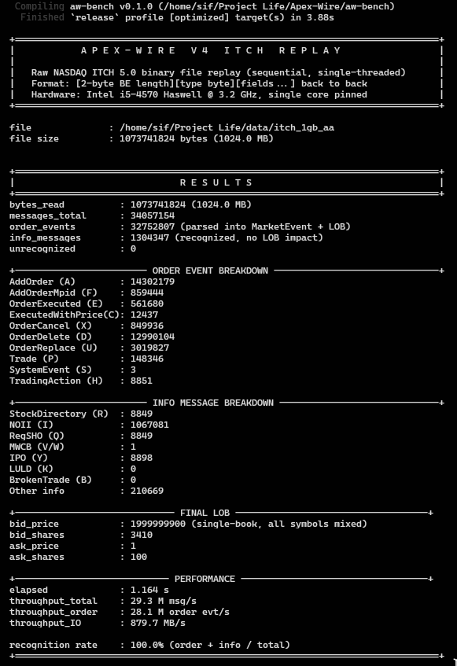

<div align="center">

# Apex-Wire V4

</div>

Low-latency market data ingestion and order entry engine. V4 adds live network multicast ingress, binary (OUCH 5.0) and FIX 4.4 order entry, latency budget instrumentation, strategy hot-reload, and production hardening on top of the V3 pipeline. Validated against a full day of real NASDAQ ITCH 5.0 data: 282,229,684 messages, 8.3 GB, 100% recognition.

For V2 and V3 feature history, see `docs/V2.md` and `docs/V3.md` (referenced; prior READMEs preserved in git history).

---

## Headline Result

**29.3 M messages/sec** (28.1 M order events/sec) parsing real NASDAQ ITCH 5.0 through a full limit order book, single core, 2013 Haswell i5.
<div align="center">
  


</div>

---

## Real Data Benchmark

Source: `07302019.NASDAQ_ITCH50` from `emi.nasdaq.com`. Full trading day, decompressed to 8,260 MB raw binary.

### 1 GB chunk (page-cache warm)

| Metric | Value |
| :--- | :--- |
| File size | 1,024 MB |
| Total messages | 34,057,154 |
| Order events (parsed + LOB applied) | 32,752,807 |
| Info messages (recognized, no LOB impact) | 1,304,347 |
| Unrecognized | 0 |
| Recognition rate | 100.0% |
| Elapsed | 1.164 s |
| Throughput (total) | 29.3 M msg/s |
| Throughput (order events) | 28.1 M order evt/s |
| IO throughput | 879.7 MB/s |

### Full day (8.3 GB, exceeds RAM)

| Metric | Value |
| :--- | :--- |
| File size | 8,260 MB |
| Total messages | 282,229,684 |
| Order events | 278,259,674 |
| Info messages | 3,970,010 |
| Unrecognized | 0 |
| Elapsed | 15.27 s |
| Throughput (total) | 18.5 M msg/s |
| Throughput (order events) | 18.2 M order evt/s |
| IO throughput | 540.9 MB/s |

The full-file run is IO-bound at the SATA SSD sequential-read ceiling (~540 MB/s). The 1 GB chunk fits in OS page cache and shows the engine's actual compute throughput (~880 MB/s IO, ~29 M msg/s).

### Context

| System | Throughput | Notes |
| :--- | :--- | :--- |
| NASDAQ peak live rate | 1-2 M msg/s | Real production feed |
| Java SBE (Aeron) | 5-10 M msg/s | Parse only, modern Xeon |
| C++ ITCH parsers | 15-40 M msg/s | Parse only, modern Xeon |
| Apex-Wire V4 | 28.1 M order evt/s | Parse + LOB apply, 2013 Haswell i5 |

Apex-Wire includes LOB insertion in the measured path; most published benchmarks measure parse-only. Modern hardware (Ice Lake, Zen 4) is expected to improve this proportionally with memory bandwidth and IPC gains, though this has not been measured.

---

## V4 New Features

### Live Network Ingestion (`aw-net`)

* `recvmmsg` batch receiver, up to 64 UDP packets per syscall.
* `MulticastReceiver`: IGMP group join, configurable `SO_RCVBUF`, dedicated ingest thread feeding into a Disruptor ring.
* Code is implemented and unit-tested. Not yet validated against a live NASDAQ feed (requires 10GbE+ NIC with multicast support).

### OUCH 5.0 Order Entry (`aw-exchange::ouch`)

* NASDAQ OUCH 5.0 binary codec.
* Outbound: EnterOrder (38B), CancelOrder (18B), ReplaceOrder (34B).
* Inbound: Accepted, Rejected, Canceled, Executed, BrokenTrade, Replaced.
* `OuchFramer` for length-prefixed TCP stream framing.

### FIX 4.4 Order Entry (`aw-fix-gateway`)

* Session layer: Logon, Heartbeat, Logout, TestRequest.
* Application layer: NewOrderSingle (D), ExecutionReport (8).
* `FixSession`: TCP state machine, sequence tracking, send buffer management.
* `FixGateway`: order thread consuming `OrderCommand` from the pipeline Disruptor, encoding FIX, writing to TCP socket.

### Latency Budget Instrumentation (`aw-core::budget`)

* 11 named pipeline stages with configurable cycle budgets.
* `BudgetReport::check()` validates each stage against its budget.
* `BudgetReport::print()` outputs pass/fail per stage with headroom percentage.

### Strategy Hot-Reload (`aw-pipeline::strategy`)

* `Strategy` trait: `on_event(&mut self, event: &MarketEvent) -> Option<OrderCommand>`.
* Built-in strategies: `PassthroughStrategy`, `MomentumStrategy`.
* `StrategyRegistry`: `RwLock`-guarded, swap strategies without restarting the pipeline.

### Production Hardening (`aw-core::harden`)

* Signal handling: SIGINT/SIGTERM graceful shutdown via atomic flag.
* `pin_thread`: CPU affinity binding via `pthread_setaffinity_np`.
* `set_realtime`: SCHED_FIFO scheduling policy.
* `lock_memory`: `mlockall` to prevent page faults in the hot path.
* `Watchdog`: periodic liveness check with configurable timeout.
* `ProductionGuard`: RAII guard combining all hardening steps.

### V3.5 Optimizations (merged into V4)

| Optimization | Before | After |
| :--- | :--- | :--- |
| Paper engine price lookup | O(n) linear scan | O(1) bitmap index |
| Pipeline handoff | Direct function calls | SPSC Disruptor ring (64K slots, HugePage-backed) |
| Shadow logging | Synchronous per-event | Deferred SPSC ring + background flush thread |

Pipeline bench after optimizations: 60.4 M events/sec through 64K Disruptor, 26 cyc publish avg, 25 cyc LOB apply avg.

---

## Measurement Methodology

* **Host:** Intel Core i5-4570 Haswell @ 3.20 GHz, 11 GB RAM, Arch Linux 7.2.9-arch1-1.
* **NIC:** Intel I217-LM (e1000e). Does not support AF_XDP, XDP, or precision hardware timestamping. All network-related V4 benchmarks use loopback or file replay.
* **Pinning:** `taskset -c 2`, `performance` CPU governor, `ulimit -l unlimited`.
* **Timing:** x86 `rdtsc`. All reported cycle counts are net of 18-cycle `rdtsc` instruction overhead.
* **Cache:** 50ms spin-warm before measurement.
* **Real data:** NASDAQ ITCH 5.0 file from `emi.nasdaq.com`, real exchange data.

---

## Test Status

**95 unit tests pass, 0 failures** across 32 crates (`cargo test --workspace`).

Pre-existing compile warnings in `aw_v2_benchmark.rs`, `aw_v4_benchmark.rs`, and `aw_v5_benchmark.rs` are intentionally preserved from V2/V3 history and do not affect correctness.

---

## Known Limitations

1. **No live network feed validated.** `aw-net` compiles and unit-tests pass, but the I217-LM NIC cannot receive NASDAQ multicast (requires 10GbE+). File replay is the validated real-data path.
2. **OUCH and FIX are codec-only.** Byte-level encoding and decoding are correct and tested, but no live gateway session has been established with a real NASDAQ OUCH endpoint or FIX counterparty.
3. **Replay benchmark uses a single LOB.** All ~8,000 NASDAQ symbols are mixed into one book. A production system uses per-symbol books, which introduces more cache misses and lower per-core throughput.
4. **No matching engine in replay.** Events are applied to the LOB; no price-time matching with order crossing is performed during replay.
5. **AF_XDP and VFIO are untested on this hardware.** The I217-LM NIC does not support XDP. These crates compile but cannot run end-to-end on this machine.
6. **Full-day benchmark is IO-bound.** The 8.3 GB file exceeds RAM. Throughput reflects SATA SSD sequential read speed, not engine capacity. The 1 GB chunk result (29.3 M msg/s) is the engine's compute ceiling on this hardware.

---

## Crate Layout (32 crates)

New or extended in V4:

| Crate | Status | Purpose |
| :--- | :--- | :--- |
| `aw-net` | NEW | `recvmmsg`, IGMP multicast ingress |
| `aw-fix-gateway` | NEW | FIX 4.4 session + order entry |
| `aw-exchange` | EXTENDED | OUCH 5.0 codec added |
| `aw-mcast` | EXTENDED | `ShadowDeferred` with background flush |
| `aw-core` | EXTENDED | `budget`, `harden` modules |
| `aw-pipeline` | EXTENDED | `Strategy` trait, `StrategyRegistry` |

All V2 and V3 crates are preserved unchanged.

---

## Build and Run

```bash
RUSTFLAGS="-C target-cpu=native" cargo build --release --workspace
taskset -c 2 ./target/release/aw_itch_replay /path/to/NASDAQ_ITCH50.bin
cargo test --workspace
```

---

## License

MIT
