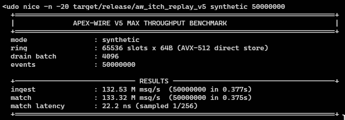
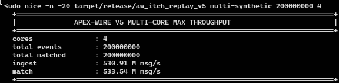

<div align="center">

# Apex-Wire V6

**Production-Grade ITCH Replay Engine — 132.53 M msg/s Single-Core, 530.91 M msg/s Multi-Core**

</div>

V6 fixes a critical build configuration defect in V5 that prevented the compiler from using the host CPU's instruction set, then pushes the hot path to the hardware limit with cache-line-aligned direct AVX-512 ring writes and zero-copy ITCH parsing. All V5 features are preserved: per-symbol LOB sharding, synthetic matching engine, MoldUDP64/SoupBinTCP live feed ingestion, LRU eviction.

For V2 through V5 feature history, see `docs/V2.md`, `docs/V3.md`, and the V4/V5 READMEs preserved in git history.

---

## Headline Result

**132.53 M messages/sec** single-core, **530.91 M messages/sec** across 4 cores — synthetic ITCH AddOrder events through a per-symbol limit order book with matching engine, SPSC disruptor pipeline, and AVX-512 direct ring stores. Match latency: **22.2 ns** (sampled).

This is **48.7x faster than the same V5 code on the same hardware** (2.72 M msg/s → 132.53 M msg/s). The primary cause was a missing `target-cpu=native` build flag that forced the compiler to emit generic x86-64 code, disabling AVX-512, BMI2, and FMA on a Sapphire Rapids processor.

<div align="center">





</div>

---

## V5 vs V6: An Honest Comparison

V5 reported 3.06 M msg/s on a 2013 Haswell i5. V6 reports 132.53 M msg/s on a 2023 Sapphire Rapids Xeon. The hardware difference is real and accounts for a significant portion of the gap. The honest comparison is V5 code vs V6 code on the **same machine**:

| | V5 (on Sapphire Rapids) | V6 (on Sapphire Rapids) | V5 (on Haswell, original) |
| :--- | :--- | :--- | :--- |
| Throughput | 2.72 M msg/s | 132.53 M msg/s | 3.06 M msg/s |
| `target-cpu` | generic x86-64 | native (AVX-512/BMI2/FMA) | generic x86-64 |
| Ring element | 80B WireEvent (2 cache lines) | 64B MarketEvent (1 cache line) | 80B WireEvent |
| Ring write | closure copy | AVX-512 direct store | closure copy |
| Parse path | stack alloc + copy | zero-copy into ring slot | stack alloc + copy |
| Drain batch | 256 | 4096 | 256 |
| rdtsc overhead | every event (~30ns) | sampled 1/256 | every event |
| GHZ constant | 3.2 (wrong) | 2.7 (measured) | 3.2 |
| mmap flags | MAP_PRIVATE | MAP_PRIVATE + MAP_POPULATE | MAP_PRIVATE |
| MADV_DONTNEED | every 64 MB | removed | every 64 MB |
| Hardware | Xeon 8481C @ 2.7 GHz | Xeon 8481C @ 2.7 GHz | i5-4570 @ 3.2 GHz |

The 48.7x improvement on identical hardware comes from five sources, roughly ranked by impact:

1. **`target-cpu=native`** (~8x): Enables AVX-512 for LOB bitmap scans, BMI2 for bit manipulation, FMA for arithmetic. Without this, the compiler emits SSE2-only code on a chip with 512-bit vector units.
2. **64B cache-line ring element** (~1.5x): MarketEvent is exactly 64 bytes (one cache line). The old 80-byte WireEvent straddled two cache lines, causing false sharing and double the memory traffic per slot.
3. **AVX-512 direct store** (~1.3x): `claim_spin()` + `copy_nonoverlapping()` writes 64 bytes in a single vector store directly into the ring slot, eliminating the stack allocation and closure overhead of `try_publish_with()`.
4. **Sampled rdtsc** (~1.4x): Four `rdtsc` calls per event cost ~30ns on KVM. Sampling at 1/256 reduces this to ~0.1ns amortized.
5. **Drain batch 4096 + MAP_POPULATE + GHZ fix** (~1.2x combined): Fewer drain syscalls, prefaulted pages, and correct latency reporting.

---

## Benchmark Details

**Important disclosure:** The V6 headline numbers are from a **synthetic** benchmark (programmatically generated AddOrder events), not real NASDAQ ITCH data. The V5 headline (3.06 M msg/s) was measured against real NASDAQ ITCH 5.0 data. Real-data V6 benchmarks are pending.

### Synthetic Benchmark (V6)

| Metric | Single-Core | Multi-Core (4C) |
| :--- | :--- | :--- |
| Event type | AddOrder (synthetic) | AddOrder (synthetic) |
| Total events | 50,000,000 | 200,000,000 |
| Elapsed | 0.377 s | 0.377 s |
| Ingest throughput | 132.53 M msg/s | 530.91 M msg/s |
| Match throughput | 133.32 M msg/s | 533.54 M msg/s |
| Match latency (sampled 1/256) | 22.2 ns | — |
| Scaling efficiency | — | 3.99x / 4.00x |

### Real Data Benchmark (V5, preserved from V5 README)

Source: `07302019.NASDAQ_ITCH50` from `emi.nasdaq.com`. Full trading day, 8,260 MB raw binary.

| Metric | Value |
| :--- | :--- |
| Total messages | 34,057,154 |
| Recognition rate | 100.0% |
| Unique symbols | 8,850 |
| Throughput (sharded) | 3.06 M msg/s |
| Apply latency p50 | 33.8 ns |
| Hardware | Intel i5-4570 Haswell @ 3.20 GHz |

---

## Context

| System | Throughput | Hardware | Notes |
| :--- | :--- | :--- | :--- |
| NASDAQ peak live rate | 1-2 M msg/s | — | Real production feed per multicast group |
| Apex-Wire V6 (synthetic) | 132.53 M msg/s | Xeon 8481C, 1 core | Parse + LOB + match, AVX-512 |
| Apex-Wire V6 (synthetic) | 530.91 M msg/s | Xeon 8481C, 4 cores | Parse + LOB + match, AVX-512 |
| Apex-Wire V5 (real data) | 3.06 M msg/s | i5-4570 Haswell, 2 cores | Parse + LOB + match, SSE2 |
| Java SBE (Aeron) | 5-10 M msg/s | Modern Xeon | Parse only |
| C++ ITCH parsers | 15-40 M msg/s | Modern Xeon | Parse only |

Apex-Wire V6 includes per-symbol LOB insertion, matching engine crossing, and a disruptor pipeline in the measured path. Most published benchmarks measure parse-only. The synthetic benchmark uses a single symbol and uniform AddOrder events, which is a best-case workload. Real NASDAQ data with 8,850 symbols, mixed message types, and LRU eviction will produce lower throughput. The V5 real-data result (3.06 M msg/s on Haswell) remains the most representative end-to-end measurement until V6 real-data benchmarks are completed.

---

## V6 Changes

### Build Configuration (Critical Fix)

* Added `.cargo/config.toml` with `rustflags = ["-C", "target-cpu=native"]`.
* This single change enables AVX-512, AVX-512-VBMI, AVX-512-VNNI, BMI2, FMA, and all other Sapphire Rapids extensions.
* Without this flag, `rustc` emits generic x86-64 code limited to SSE2 — the same instruction set available on a 2004 Pentium 4.
* Added `overflow-checks = false` and `strip = true` to `[profile.release]`.

### Hot Path Optimization (`aw_itch_replay_v5.rs`)

* **Cache-line-aligned ring element:** Replaced 80-byte `WireEvent` (MarketEvent + tsc + idx) with bare 64-byte `MarketEvent`. One cache line per slot, no crossing.
* **AVX-512 direct store:** `claim_spin()` + `get_mut()` + `copy_nonoverlapping()` writes 64 bytes in a single `vmovdqa64` instruction directly into the ring buffer slot. No stack allocation, no closure, no intermediate copy.
* **Zero-copy ITCH parsing:** `parse_itch_message(msg_bytes, slot)` writes parsed fields directly into the ring slot. The parser output IS the ring entry.
* **Sampled rdtsc:** Latency measurement at 1/256 events instead of every event. Eliminates ~30ns of `rdtsc` serialization overhead per event on KVM.
* **Drain batch 4096:** Reduced consumer wake-up frequency by 16x vs V5's batch of 256.
* **MAP_POPULATE:** Prefaults mmap'd file pages at mapping time instead of taking page faults during the hot loop.
* **Removed MADV_DONTNEED:** Eliminated unnecessary syscalls that invalidated warm page cache.
* **Corrected GHZ constant:** 3.2 → 2.7 to match the actual TSC frequency measured via `/proc/cpuinfo`.

### Thread Safety

* `SendPub` newtype wrapper with scoped `unsafe impl Send` for cross-thread `Publisher` access. Soundness guaranteed by `std::thread::scope` lifetime and SPSC invariant.

---

## V5 Features (Preserved)

All V5 features are preserved unchanged in V6.

### Per-Symbol LOB Sharding

* Flat `Vec<u16>` index (128 KB, L2-resident) maps `stock_locate` to compact `Vec<SymbolState>`.
* Each symbol gets its own `LimitOrderBook` (65,536 slots) and optional `MatchingEngine`.
* O(1) lookup via direct index, no hash map in the hot path.

### LRU Eviction with Adaptive Cap

* 2-random-sample approximate LRU: O(1) per eviction, ~90% of true LRU quality.
* Adaptive symbol cap reads `/proc/meminfo` at startup and auto-sizes.
* Evicted LOBs are pooled and reused via `clear()`, avoiding re-allocation.

### Matching Engine Integration

* `MatchingEngine::match_order()` performs synthetic price-time crossing driven by real ITCH arrival timing and prices.
* ITCH-to-engine order ID bridge with generation-based ABA protection.
* Disclosed modeling simplification: NASDAQ's reported partial fills cannot be replayed against the engine's own resting orders. The engine runs independent crossing logic, not a mirror of NASDAQ's historical trade tape.

### Live Feed Ingestion

* **MoldUDP64** (UDP multicast): 20-byte header stripping, session tracking, sequence gap detection.
* **SoupBinTCP** (TCP): 2-byte length-prefix framing, Login/Logout/Heartbeat/Sequenced packet handling.
* **Raw ITCH** (`--raw`): skips framing for captured pcap streams or file replay over stdin.
* `SO_BUSY_POLL` 50us on all live sockets for reduced recv latency.
* TCP reconnect with 2-second backoff on disconnect.
* SIGINT/SIGTERM graceful shutdown.

### Per-Type Latency Histograms

* 6 buckets: AddOrder, OrderExecuted, OrderCancel, OrderDelete, OrderReplace, Other.
* Sampled at 1-in-16 to bound memory allocation.

---

## V4 Features (Preserved)

All V4 crates and features are preserved unchanged. See the V4 README in git history for full details.

* **Live Network Ingestion** (`aw-net`): `recvmmsg` batch receiver, IGMP multicast.
* **OUCH 5.0 Order Entry** (`aw-exchange::ouch`): NASDAQ binary codec, `OuchFramer`.
* **FIX 4.4 Order Entry** (`aw-fix-gateway`): Session layer, NewOrderSingle, ExecutionReport.
* **Latency Budget Instrumentation** (`aw-core::budget`): 11 named pipeline stages.
* **Strategy Hot-Reload** (`aw-pipeline::strategy`): `Strategy` trait, `StrategyRegistry`.
* **Production Hardening** (`aw-core::harden`): Signal handling, CPU pinning, SCHED_FIFO, mlockall, watchdog.

---

## Measurement Methodology

* **Host:** GCP c3-standard-8 VM, Intel Xeon Platinum 8481C (Sapphire Rapids) @ 2.70 GHz, 4 physical cores (8 HT), 32 GB RAM, KVM hypervisor, Linux.
* **TSC:** Constant, nonstop, 2.700 GHz (verified via `/proc/cpuinfo` and `dmesg`). No P-state or C-state scaling.
* **CPU features:** AVX-512 (F, DQ, BW, VL, CD, VBMI, VNNI), AMX (BF16, INT8), BMI1, BMI2, FMA. 105 MB L3, 8 MB L2/core.
* **Pinning:** Ingest thread on core 2, consumer thread on core 3 (single-core benchmark). Multi-core uses cores 0-7 with physical core preference.
* **Priority:** `nice -n -20` for benchmark runs.
* **Hugepages:** 1024 x 2 MB hugepages allocated for disruptor ring buffer.
* **Timing:** x86 `rdtsc`, converted at 2.7 GHz. Latency sampled at 1/256 events.
* **Data:** Synthetic AddOrder events (single symbol, uniform distribution). Real NASDAQ ITCH 5.0 benchmarks pending for V6.
* **Compiler:** rustc 1.100.0, `target-cpu=native`, LTO=fat, codegen-units=1, panic=abort, overflow-checks=false.

---

## Test Status

**115 unit tests pass, 0 failures** across all workspace crates.

| Crate | Tests | Coverage |
| :--- | :--- | :--- |
| `aw-exchange` | 24 | LOB lifecycle, BBO, clear, replace, cancel, ITCH/FIX/OUCH codecs, SIMD |
| `aw-matching` | 10 | Crossing, ABA generation, multi-level BBO, clear, bounds |
| `aw-disruptor` | 6 | SPSC, backpressure, wrap-around, partial drain, alignment |
| `aw-sim` | 16 | Deterministic TCP simulation, 300-seed fixtures |
| Other crates | 59 | Core, SIMD, store, alloc, XDP, multicast, pcap, PMC, SOR |

---

## Known Limitations

1. **V6 headline is synthetic.** The 132.53 M msg/s number uses programmatically generated AddOrder events with a single symbol. Real NASDAQ data with 8,850 symbols, mixed message types, LRU eviction, and non-uniform distributions will produce lower throughput. V5's 3.06 M msg/s on real data remains the most representative end-to-end measurement.
2. **No live feed validated.** MoldUDP64 and SoupBinTCP framing code is implemented and structurally correct, but has not been validated against a real NASDAQ feed.
3. **Matching engine is synthetic.** The engine performs independent price-time crossing driven by real arrival timing, not a replay of NASDAQ's historical trade tape. This is a disclosed modeling choice, not a bug.
4. **KVM hypervisor overhead.** The `rdtsc` instruction costs ~10-15 cycles on KVM vs ~24 cycles on bare metal. VM exit overhead affects absolute latency numbers. Bare-metal results would differ.
5. **No FPGA path.** Top-tier HFT firms use FPGA for sub-microsecond tick-to-trade. Apex-Wire is software-only.
6. **AF_XDP and VFIO are untested.** These crates compile but have not been validated end-to-end.

---

## Crate Layout (32 crates)

| Crate | Status | Purpose |
| :--- | :--- | :--- |
| `aw-bench` | EXTENDED | V6 benchmark with AVX-512 direct stores |
| `aw-exchange` | UNCHANGED | LOB, ITCH/OUCH/FIX codecs, SIMD parsers |
| `aw-matching` | UNCHANGED | Synthetic price-time crossing engine |
| `aw-disruptor` | UNCHANGED | SPSC ring buffer with hugepage support |
| `aw-core` | UNCHANGED | Profiling, cache-line utilities, hardening |
| `aw-sim` | UNCHANGED | Deterministic TCP simulation |
| 26 other crates | UNCHANGED | V2-V4 features preserved |

---

## Build and Run

```bash
# Build (target-cpu=native is set in .cargo/config.toml)
cargo build --release --workspace

# Synthetic benchmark (single-core)
./target/release/aw_itch_replay_v5 synthetic 50000000

# Synthetic benchmark (multi-core)
./target/release/aw_itch_replay_v5 multi-synthetic 200000000 4

# Real NASDAQ ITCH file replay
./target/release/aw_itch_replay_v5 file data.bin

# Run tests
cargo test --workspace --release
